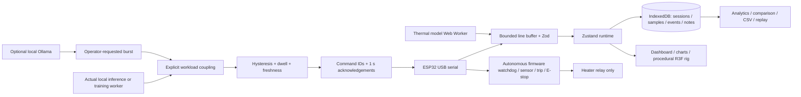

# Architecture

The runtime has four exclusive states: DISCONNECTED, LIVE, SIMULATED, REPLAY. Disconnected never generates measurements. Replay never has a live command transport. Every recorded sample carries source provenance; replay preserves it. Header source chip, frame/banner and exported CSV make simulation explicit.

Physical control requires v2, matching trip configuration, fresh fault-free telemetry, an armed firmware relay interlock and minimum relay dwell. OFF and E-stop bypass dwell. Commands are pending before send, matched by ID, rejected when firmware says accepted=false, and timed out after one second. A timeout disables automatic control and sends OFF. Boot and safety reset never energize heat.

The underlying Web Serial API requires a user gesture and secure context. RequestPort permission cancellation is surfaced. Read/write locks and stream resources are released on disconnect; serial writes are ordered. Firmware bounds work per loop so input floods cannot starve the watchdog.

Charts preserve >2 s data gaps, optional probe data and source labels. Derived thermal metrics use stored samples. Session recordings are durable within the browser origin; failures surface prominently and disable heating. There is no claim of cloud backup, multi-operator arbitration or calibrated instrumentation.

3D units are 10 cm. Model proportions are illustrative while the current vessel/blocks follow the approximate documented dimensions. Glass and water use physical materials, metal parts use local procedural environment lighting, and repeated fins/pins are instanced. No remote assets are needed. Demand rendering, capped DPR and low quality reduce GPU cost. A performance target is not a verified frame-rate claim.

## Requirements reconciled

The second user-supplied reference supersedes earlier palette/typography and initial-route choices: dashboard is `/`, product overview is `/about`; headings use Space Grotesk. Original live-rendered procedural geometry remains the portable implementation, with no Blender runtime dependency. The reference's apparent green algae water, heater temperature, pump ON status and other numerical examples are not reproduced as factual readings. The heat exchanger remains submerged in an isolated closed circuit. Green culture appears only in the planned biological scene.
