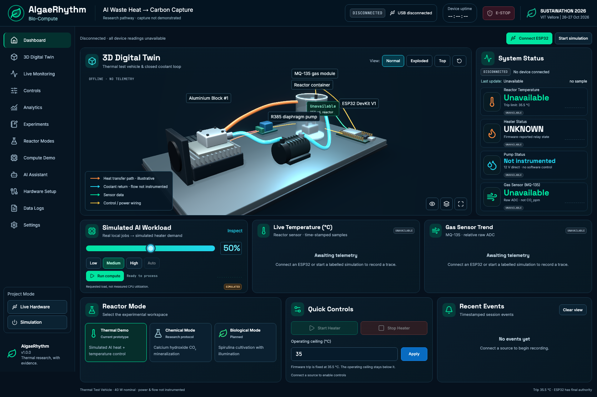
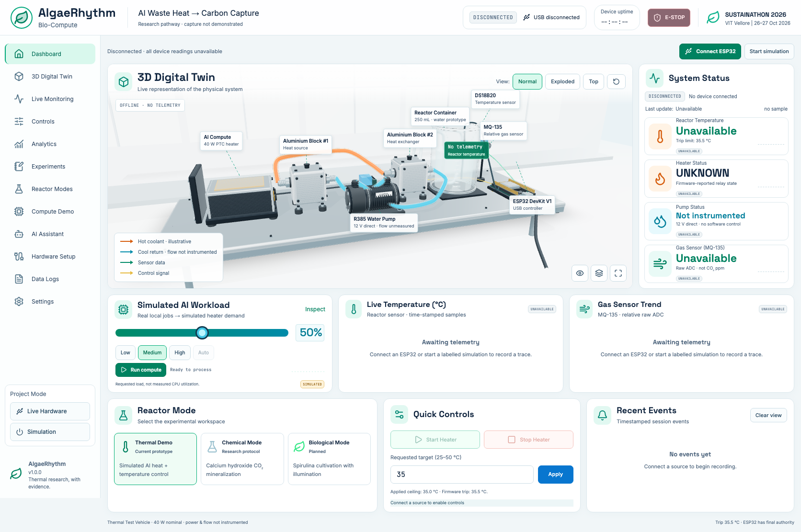
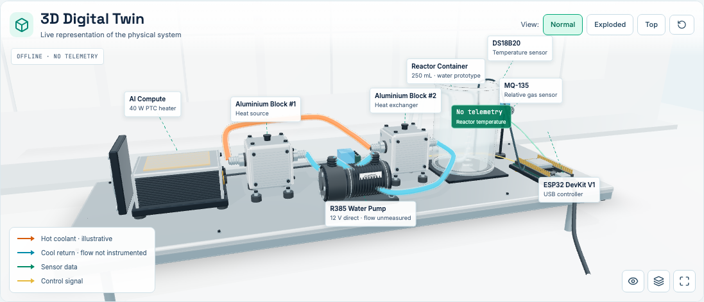
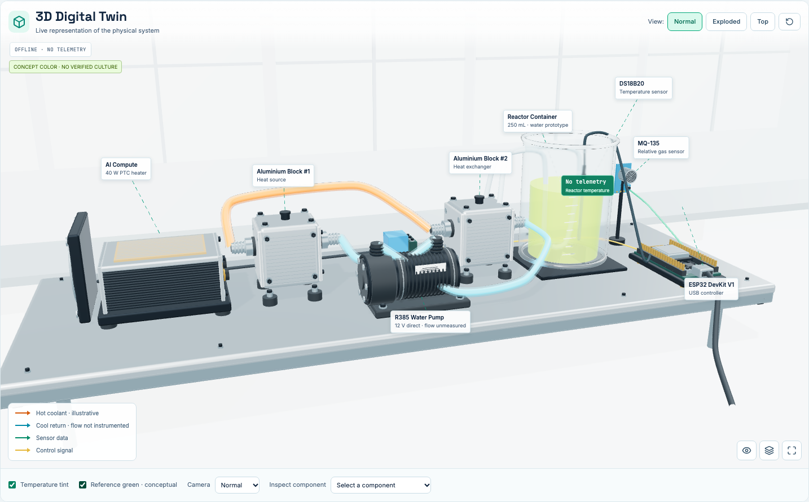
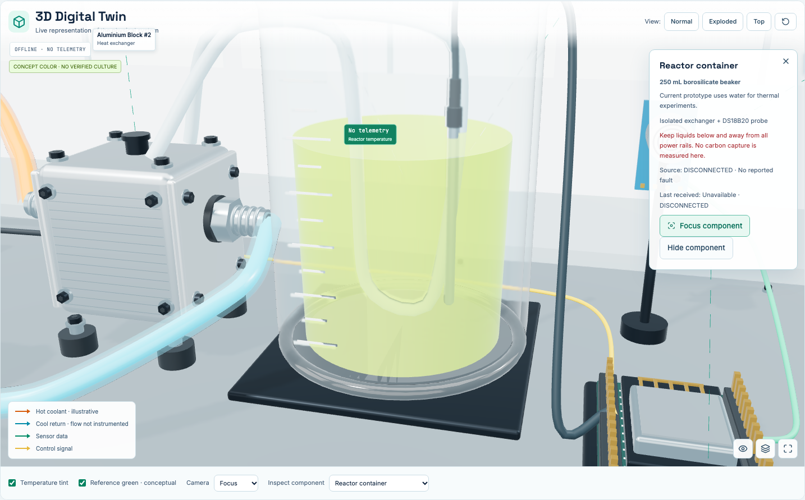
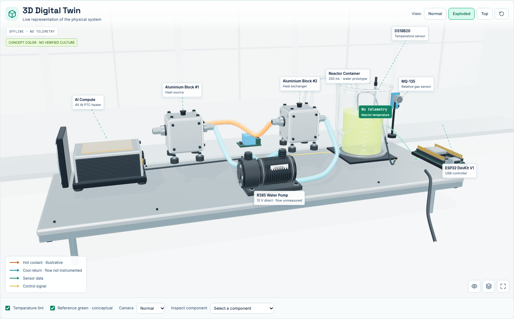
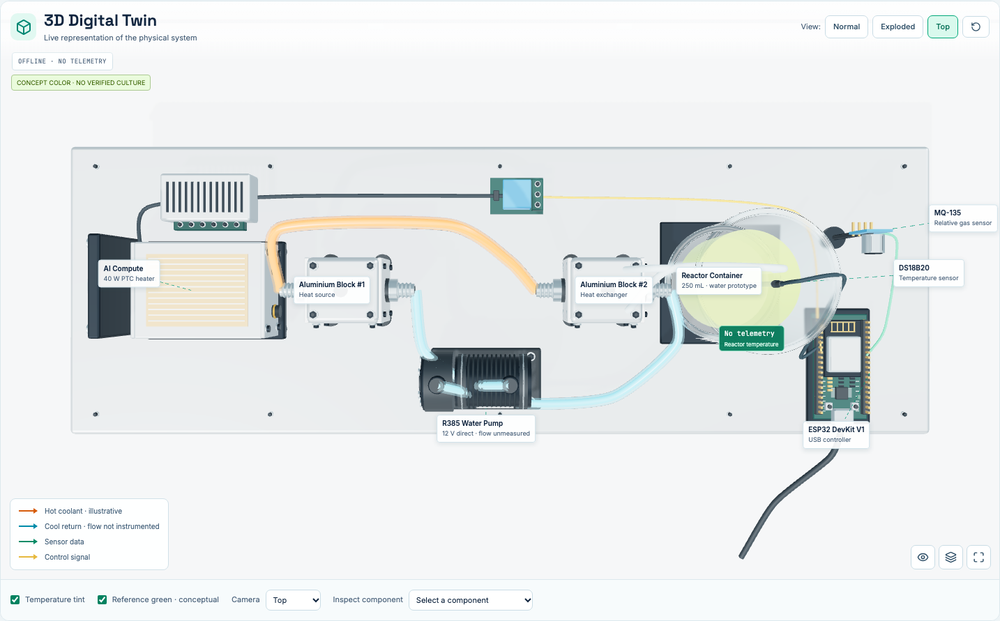
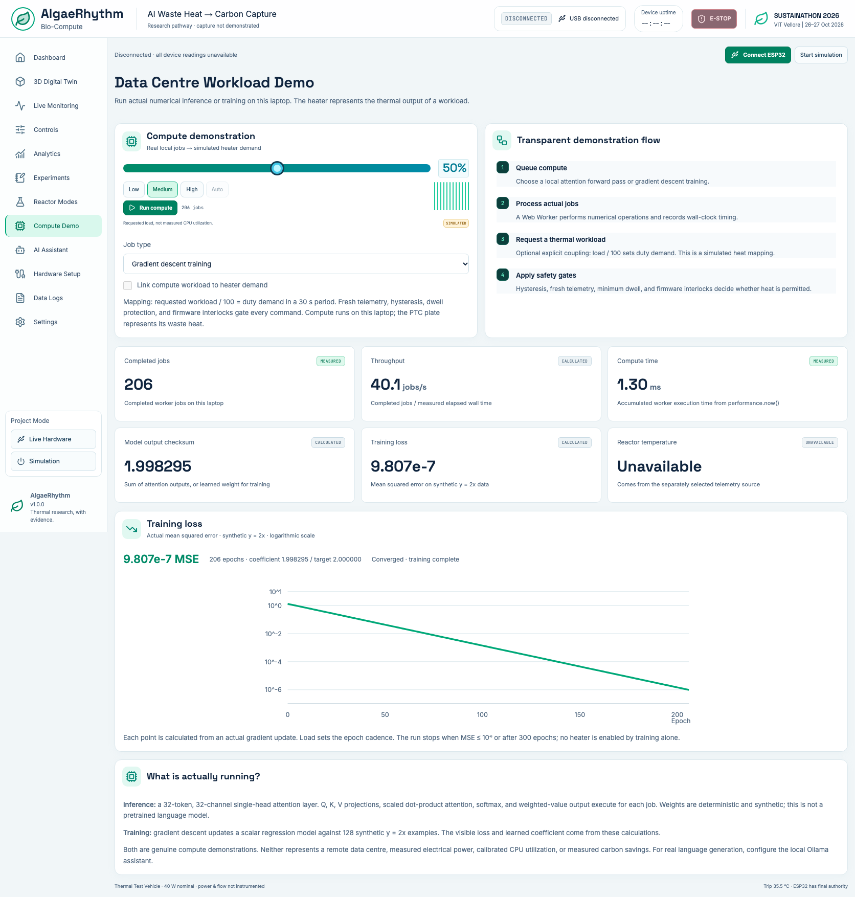

# Digital twin visual review — 27 October 2026

The user is building an interactive laboratory apparatus that shares ESP32/simulation/replay data with the dashboard. The reviewed flow is source selection → validated runtime telemetry → equipment/labels/status/chart rendering, plus requested temperature → bounded control requests and compute training → actual loss history.

## Reference comparison

| Area | Earlier application | Rebuilt application |
| --- | --- | --- |
| Equipment | Sparse box/cylinder assemblies; block #1 placed on heater; block #2 hard to distinguish | Original GLB assemblies; two visible machined blocks, fittings, socket heads, mounts, detailed pump, heater, and PCB |
| Composition | Dark empty environment and a distant diagonal rig | Bright windowed laboratory, horizontal equipment hierarchy, revised three-quarter view and supporting bench |
| Reactor | Open thin cylinder and simple fill | Lathed inner/outer wall profile, rolled rim, base, graduations, visible liquid level and isolated transfer loop |
| Labels | Floating equipment captions with overlap | White technical annotations, leaders, separated sensor anchors, source and freshness indications |
| Controls | High limit hard-clamped in the number input | Requested 25–50 °C with a separately displayed effective ceiling; manual heating also respects a lower ceiling |
| Training | Converged before first reported sample; no learning plot | Actual epoch history and log MSE curve, matching weight/loss pair, explicit completion |

The screenshot below is the running application, not a reference image applied to a plane. All equipment remains orbitable, selectable, and rendered from geometry.

### Before

### After

### Apparatus detail and conceptual reference appearance

### Compute result

Observed run: initial MSE 1.349, 206 gradient epochs, final MSE 9.807e-7, learned coefficient 1.998295 toward the known synthetic target 2. The requested load controls cadence; this does not train the Ollama model.

## Verification and limits

- Real browser captures used Chromium at a 1672 × 1040 viewport; the automated regression suite uses 1536 × 1024 and 390 × 844. Medium/high visual review and low-quality functional checks exercise distinct renderer settings.
- Reviewed normal/top/front/isometric/focus/reset, orbit/zoom, exploded placement, equipment selection/hiding, conceptual color, telemetry provenance, and component inspector.
- Low-quality browser regression includes WCAG A/AA scan, simulator faults/watchdog/reset, acknowledged heat requests, operating-ceiling enforcement, recording/export/replay, actual training completion, and mocked Web Serial validation/timeout/staleness/disconnect.
- One high-quality software-renderer capture latched a simulated fault and correctly showed heat OFF. That image is retained as `review/simulated-fault-off.png`; it is not presented as an active-heater success. A generalized GPU frame-rate target has not been certified.
- Blender was unavailable. These are original detailed scripted GLB assets, not manufacturer CAD, a Blender/Cycles render, or a pixel-identical reproduction of the generated reference. The laboratory background is real-time geometry, with simpler environmental detail than the reference photograph.
- The current fluid is water, with a separate labeled concept color. There is no measured pump flow, heater-surface temperature, carbon capture, or verified algae growth. The 35.5 °C firmware trip is unchanged.
- Physical USB hardware was not commissioned or flashed during this work. Automated serial tests use a declared fixture and do not certify wiring, relay polarity, flow, or physical thermal response.

Final recorded checks: **58 unit tests, native firmware safety suite, and 9 browser scenarios passed**, together with lint, formatting and production build. The final single-process browser run passed active-stream navigation, focus/visibility and manual ceiling shutdown. A final high-quality render was captured after the coolant color core was refined to preserve the reference's red/cyan distinction under bright lighting.
