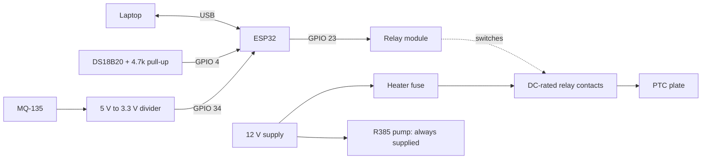
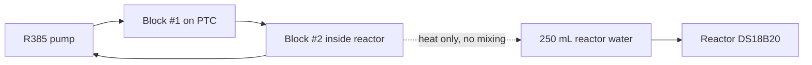

# Electrical and fluid bring-up

**No physical verification is implied by this document.** Test with a safe load before applying heater power. Keep mains enclosed and keep the wet loop away from all power rails.

| Part | Connection / requirement |
|---|---|
| ESP32 DevKit V1 | USB logic supply and serial, 115200 baud |
| DS18B20 | DATA GPIO 4; VDD 3.3 V; GND; 4.7 kΩ DATA→3.3 V |
| Optional DS18B20 #2 | Same OneWire bus, physically attached to Block #1; set SECOND_PROBE_REQUIRED after commissioning |
| MQ-135 | AO → verified voltage divider → GPIO 34; never apply a 5 V analog output directly |
| Relay | IN GPIO 23; module supply per actual board; verify opto-isolation/jumper wiring and compatible logic level |
| Relay contacts | DC-rated at 12 V / at least 3.3 A plus suitable margin; fuse heater rail |
| Heater | 40 W PTC, nominal 12 V / 3.3 A, clamped thermally to Block #1 |
| R385 pump | Direct, separate 12 V branch, nominal ~1.2 L/min; no ESP32 switching |
| Supply | 12 V / 5 A for pump and heater; USB for ESP32 |
| Fluid | Approximately 80 mL distilled loop water, 6 mm ID / 8 mm OD tubing |
| Reactor | 250 mL borosilicate beaker with water for thermal demonstration |

1. Inspect DC contact current rating, fuse, cable gauge, enclosure and strain relief. Add a correctly chosen hardware pull-up/down at the relay input so reset/boot ROM pin states keep it OFF. Firmware alone cannot establish pre-boot GPIO behavior.
2. Disconnect heater supply. Flash the default interlocked firmware. Confirm valid sensor JSON at 115200 and `armed:false`.
3. Verify relay polarity with a suitable test lamp, following the relay manufacturer's wiring, and with heater power disconnected. Correct RELAY_ACTIVE_LOW, set RELAY_POLARITY_VERIFIED true, reflash, and check OFF at boot, reset and USB removal. Never infer polarity from the software model.
4. DallasTemperature discovers OneWire addresses at boot: index 0 is reactor, index 1 optional plate. **Record actual probe ROM addresses and verify physical mapping after any bus changes before heating.** A disconnected device present at boot becomes a fault when readings fail. Set SECOND_PROBE_REQUIRED=true when the second probe is mandatory; absence then faults.
5. Verify primary and secondary sensor-disconnect shutdown, ≥35.5 °C trip, bad-command shutdown, E-stop, >3 s heartbeat loss, and fresh-reading/cooldown reset with the test lamp.
6. Leak-test the closed loop using distilled water and pump power only. Verify circulation physically; no flow telemetry exists.
7. Confirm all liquids are physically below and away from the breadboard and DC rails. Attach the heater only after the cold-plate cooling and safety procedures pass.
8. Supervise the first heater run, using an independent reference thermometer and physical supply cutoff. A beaker-only probe is insufficient to detect local source overheating if the pump fails.

For alkaline chemistry, replace or isolate bare aluminium Block #2. Aluminium in high-pH lime water can release hydrogen. Do not conduct that chemistry using the bare-aluminium water-demo configuration.
